# Timecon

Timecon (от time consuming) — планировщик дня с обычными задачами, таймерами, заметками и учётом денег.

Приложение работает как веб-приложение (PWA): открывается в браузере, ставится на iPhone и компьютер, работает без интернета и синхронизируется между устройствами. Устанавливать ничего не нужно, магазин приложений не требуется.

**Открыть:** https://timecon.space/

**Новое в v34:** при создании задачи включи **«Повторять каждый день»** — она автоматически появится в следующих днях. Работает и без таймера, и с учётом времени; каждый день отмечается отдельно.

## Демонстрация

Обычный список дел, задачи с живым таймером, заметки, статистика и финансы — реальные экраны **Rust / WebAssembly-версии Timecon**. Все задачи, заметки и операции в примерах демонстрационные.

### Ежедневное повторение

Один раз включи повтор в форме создания — зарядка, чтение и другие регулярные дела появятся в следующих днях автоматически.

<p align="center">
  <a href="docs/demo/daily-form.png">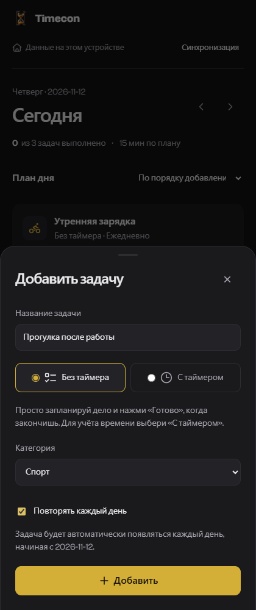</a>
  <a href="docs/demo/daily-tasks.png">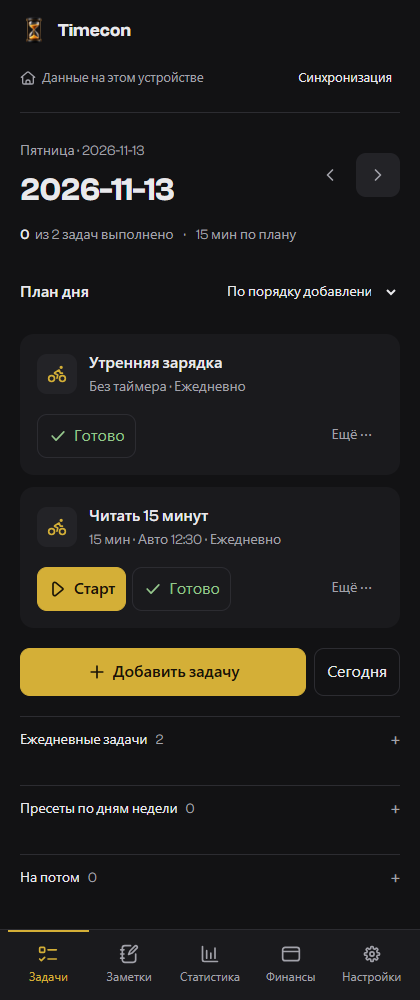</a>
</p>

### План дня без таймера

Запиши покупки, звонки и другие дела без длительности и обратного отсчёта. Кнопка **«Готово»** отмечает выполненное; в одном плане можно сочетать обычные задачи и задачи с таймером.

<p align="center">
  <a href="docs/demo/day-plan.png">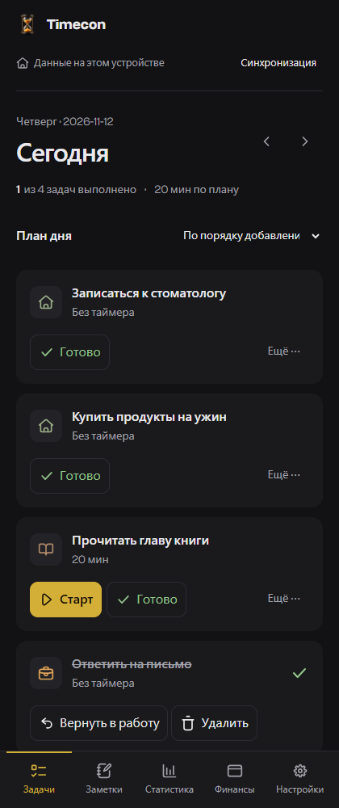</a>
  <a href="docs/demo/task-form.png">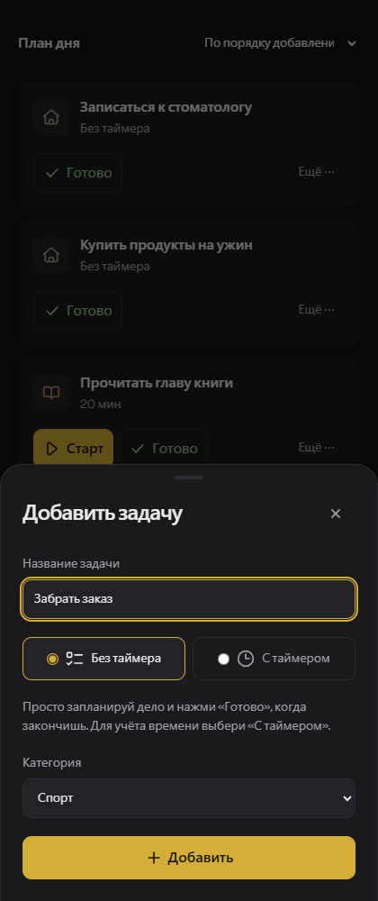</a>
</p>

### Как это работает

Короткая демонстрация: план дня → добавление задачи → запуск и отсчёт таймера → заметки с кодом → статистика → финансы → светлая тема.

<p align="center">
  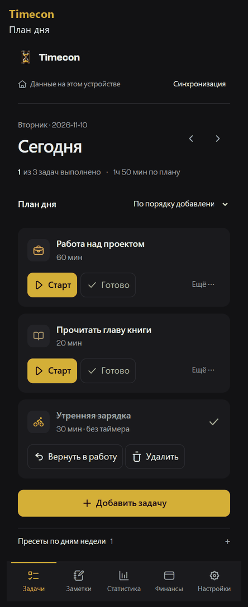
</p>

### Задачи, статистика и финансы

Активный таймер и план дня, результаты за неделю, баланс и расходы по категориям. Нажми на скриншот, чтобы рассмотреть его в полном размере.

<p align="center">
  <a href="docs/demo/tasks.png">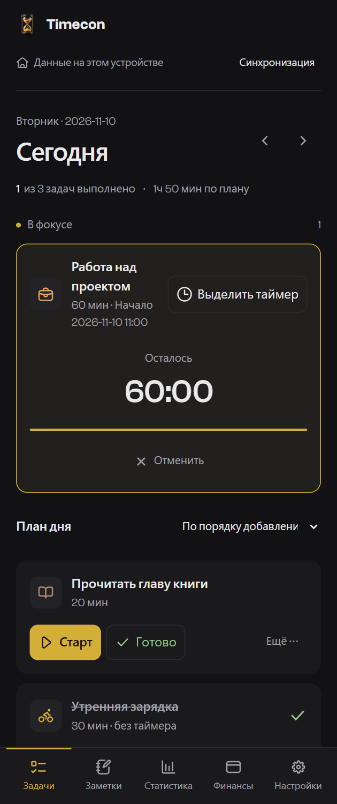</a>
  <a href="docs/demo/stats.png">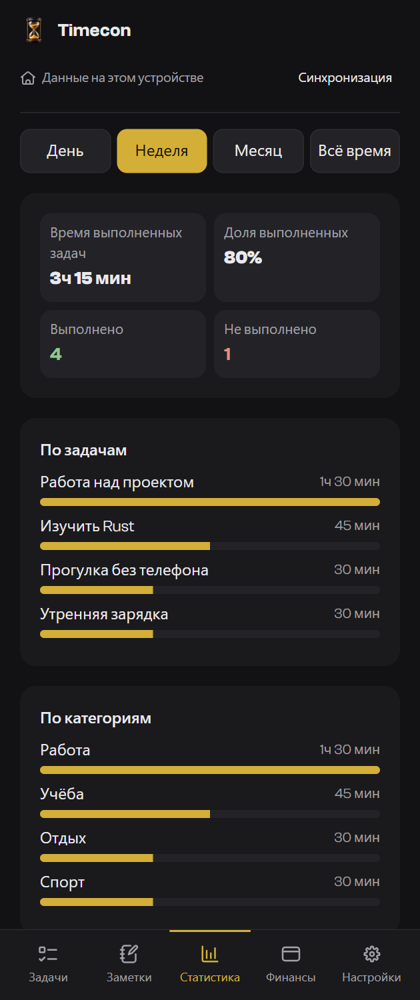</a>
  <a href="docs/demo/finance.png">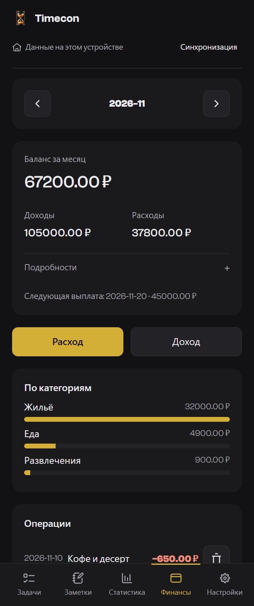</a>
</p>

### Заметки, код и светлая тема

Список заметок, редактор с текстовыми блоками и подсветкой Rust, план дня с обычными задачами в светлой теме.

<p align="center">
  <a href="docs/demo/notes.png">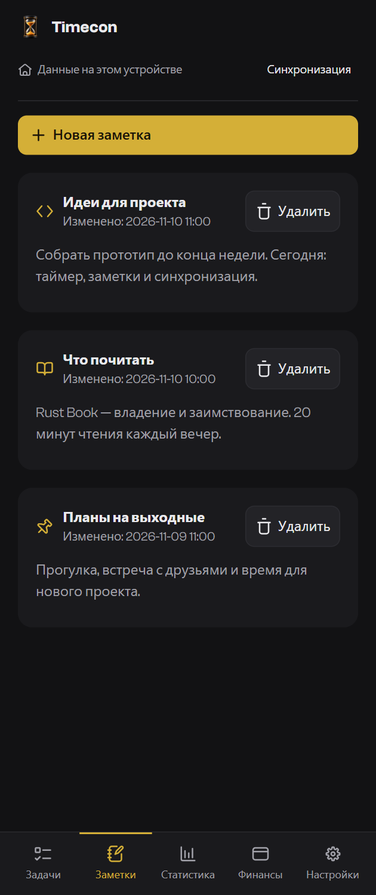</a>
  <a href="docs/demo/note-editor.png">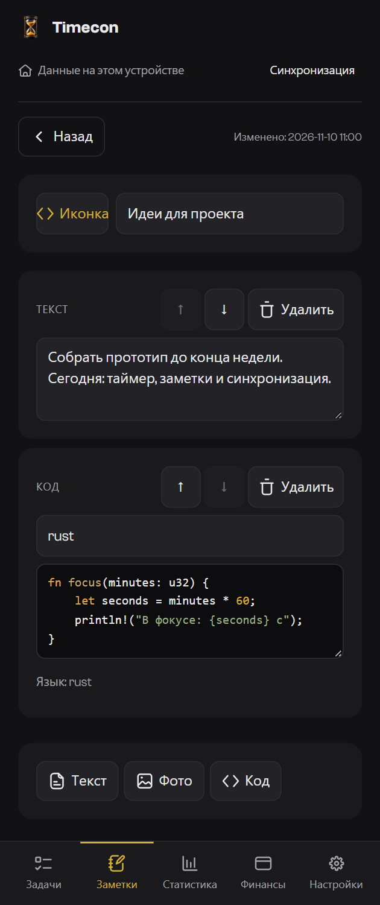</a>
  <a href="docs/demo/light-theme.png">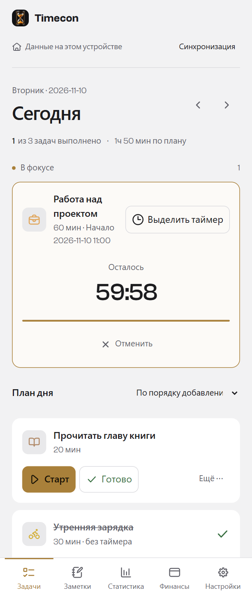</a>
</p>

<details>
<summary>Приветственная карточка с обзором возможностей</summary>

<p align="center">
  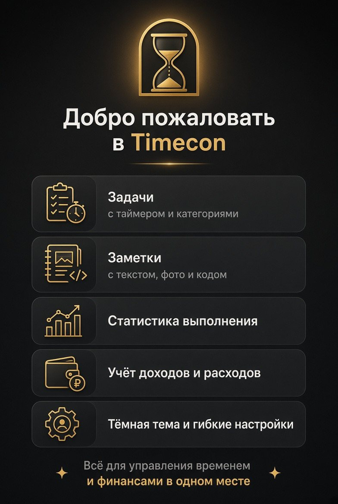
</p>

</details>

---

## Зачем это приложение

День заканчивается, а непонятно, на что он ушёл. Timecon отвечает на три вопроса:

1. **Что я планировал на сегодня и успел ли.** Добавляй обычные задачи без таймера или дела с учётом времени, составляй план вручную или из пресета. В конце дня видно, что сделано.
2. **Сколько времени ушло на каждое дело.** Время идёт в реальном времени: его нельзя поставить на паузу. Сколько времени реально заняли спорт, работа или учёба — видно в статистике за день, неделю, месяц или всё время.
3. **Куда уходят деньги.** Расходы по группам, экономия за месяц и доля трат, которые были не нужны.

Смысл в том, чтобы держать дела под рукой, не забывать запланированное и понимать, куда уходят время и деньги. Повторяющиеся планы можно сохранить в пресеты по дням недели.

---

## Возможности

### Приветствие при первом запуске

- При первом открытии показывается приветственный экран в стиле сторисов: две карточки с полосками прогресса сверху, как в Instagram.
- Первая — знакомство с приложением и его возможностями, вторая — как добавить Timecon на экран «Домой» на iPhone.
- Листается тапом по экрану (левая часть — назад, правая — вперёд), а также кнопками **«Далее»** и **«Пропустить»**. Карточки сменяются сами по таймеру.
- Повторно не показывается. Вернуть его можно кнопкой **«Показать обучение»** в настройках.

### Задачи на день без таймера

- При добавлении задачи по умолчанию выбран режим **«Без таймера»**: достаточно названия, категорию можно выбрать в той же форме.
- Кнопка **«Готово»** отмечает дело выполненным сразу. **«Вернуть в работу»** возвращает его в план.
- Не нужно задавать длительность, запускать отсчёт или подтверждать его окончание. В карточке нет кнопок таймера и автозапуска.
- Обычные задачи можно переносить на другую дату и «на потом», сортировать, удалять и сохранять в пресеты вместе с задачами с таймером.
- Они сохраняются офлайн, синхронизируются и входят в JSON-резервную копию. В CSV поле минут у них пустое.
- Выполненные дела учитываются в счётчике и доле выполнения, но не добавляют минут в статистику времени.

### Задачи с таймером

- В форме добавления выбери **«С таймером»**, укажи название, длительность в минутах и категорию со значком.
- Нажатие **Старт** запускает обратный отсчёт в минутах и секундах.
- Паузы нет, остановить отсчёт нельзя. Запускать можно **несколько задач сразу** — у каждой свой таймер.
- Начатую задачу можно **отменить** кнопкой «Отменить» под таймером: приложение спросит подтверждение, остановит отсчёт, и задачу можно будет запустить заново. После отмены 2 минуты автозапуск не срабатывает, чтобы задачи не стартовали сразу.
- **Автозапуск по времени:** задаче можно указать время, и она запустится сама, без нажатия «Старт» — даже если в этот момент уже идут другие таймеры. Время можно задать при создании задачи или кнопкой с часами на карточке.
- **Порядок задач** меняется кнопками «выше» и «ниже» (в сортировке «По порядку добавления»).
- Когда время вышло: звук, вибрация (на Android) и уведомление.
- После сигнала вопрос **«Время вышло. Задача выполнена?»**:
  - зелёная галочка — задача зачёркнута и закрашена зелёным;
  - красный крестик — зачёркнута красным.
- Любую задачу можно **перенести**: на завтра, послезавтра, через неделю, на выбранную дату или «на потом».
- В карточке задачи видно **время начала** (момент нажатия «Старт») — по местному времени устройства.
- Раздел **«На потом»** хранит отложенные задачи, оттуда их можно вернуть в любой день.
- Сортировка списка: по порядку добавления, по категории, по статусу, по длительности.
- **Задача выполнена без таймера?** Кнопка **«Готово»** рядом со «Старт» отмечает задачу сделанной сразу, без отсчёта — для случаев, когда забыл включить таймер, а дело уже сделано. Время берётся из плана задачи.

### Пресеты по дням недели

- В разделе «Пресеты по дням недели» лежат **все сохранённые пресеты** — видно, что в каком дне запланировано, включая время автозапуска.
- Любой пресет применяется к текущему дню кнопкой **«Применить»** — не обязательно ждать нужного дня недели.
- У каждого пресета своя кнопка удаления с подтверждением.
- Кнопка **«Сохранить день как пресет»** запоминает текущий день для его дня недели.
- Ежедневные задачи в пресет не входят: они появляются автоматически и не дублируются при его применении.
- Если в дне уже есть задачи, применение спрашивает подтверждение, чтобы не получить дубликаты.

### Ежедневные задачи

- При создании задачи отметь **«Повторять каждый день»**. Повтор начинается с выбранного дня, в том числе если планируешь на будущую дату.
- Задача автоматически появляется в плане каждого следующего дня. Переключай дни вперёд — список уже будет содержать ежедневные дела. При смене даты и повторном открытии приложения они тоже добавляются автоматически.
- Работает для обоих режимов: без таймера и с таймером. Категория, длительность и время автозапуска сохраняются, а статус выполнения и отсчёт у каждого дня свои.
- **«Удалить на этот день»** убирает только один экземпляр; в остальных днях задача остаётся. Перенос тоже относится только к одному экземпляру.
- Кнопка **«Не повторять дальше»** в меню задачи или разделе **«Ежедневные задачи»** прекращает добавление после выбранного дня (не раньше завтрашнего). История и текущие таймеры сохраняются, ожидающие экземпляры после этой даты убираются.
- Правила повтора сохраняются офлайн, синхронизируются и входят в JSON-резервную копию. Одинаковые экземпляры с разных устройств объединяются без дубликатов.

### Заметки

- Отдельная вкладка для текстовых заметок.
- Заметка собирается из **блоков, которые идут сверху вниз**: текст, фото, код — в любом порядке. Например: текст, фото, текст, два фото, код.
- Блоки можно **перемещать вверх и вниз** и удалять.
- **Фото** прикрепляются из галереи или камеры телефона. Приложение сжимает их, чтобы не занимать лишнюю память.
- **Код** хранится отдельным блоком с моноширинным шрифтом. Язык **определяется автоматически** по содержимому, и синтаксис **подсвечивается** прямо при наборе. Язык можно задать и вручную (поле с подсказками): `js`, `ts`, `python`, `html`, `css`, `json`, `sql`, `bash`, `c`, `java`, `php`.
- У заметки своё **название** и **значок**. Название меняется прямо в заметке, значок выбирается из набора.
- В списке и в самой заметке видно **дату и время последнего изменения**.
- Заметки тоже синхронизируются между устройствами.

### Статистика

- Периоды: день, неделя, месяц, всё время.
- Время выполненных задач, процент выполнения, число выполненных и невыполненных задач.
- Разбивка по задачам и по категориям с наглядными полосками.

### Финансы

- Доходы и расходы, каждая трата помечается как **нужная** или **ненужная**.
- Суммы **доходов — зелёные**, **расходов — красные**, в сводке месяца и истории операций, в обеих темах.
- Расходы по группам с диаграммой.
- **Экономия** = доходы минус расходы, **доля экономии** в процентах и **доля ненужных трат**.
- Выплаты настраиваются по отдельности: например, 5-го числа — аванс, 20-го — зарплата, и у каждой выплаты своя сумма. Если выплата выпадает на выходной, она переносится на пятницу — это можно выключить.
- Валюта выбирается, по умолчанию рубли.
- Показаны ближайшая выплата и её сумма.

### Настройки и внешний вид

- Тёмная и светлая тема. Тёмная — тёмно-серая с золотыми кнопками.
- Два языка: русский и английский.
- Категории задач и расходов создаются и редактируются. У каждой — значок из набора [Keyline Icons](https://keylineicons.com) (1366 штук, MIT) и свой цвет.
- Экспорт: JSON (полная резервная копия всех данных) и CSV (для Excel и Google Таблиц — задачи, финансы и заметки).

### Синхронизация

- Один аккаунт (почта и пароль или вход через Google) на всех устройствах.
- Изменения отправляются в облако через секунду и появляются на втором устройстве **сразу, без обновления страницы** — через канал Realtime.
- Забыл пароль — ссылка **«Забыл пароль»** в разделе синхронизации: на почту придёт ссылка, по ней откроется форма нового пароля.
- Подстраховка: сверка с сервером каждые 15 секунд, при возврате в приложение и по кнопке «Синхронизировать сейчас».
- Пока вход не выполнен, сверху висит предупреждение **«Данные не сохраняются»** с кнопкой **Войти**, которая сразу открывает раздел синхронизации.
- При конфликте данные объединяются: для задач и заметок побеждает более свежая правка.
- Работает без интернета: правки копятся локально и уходят в облако, когда связь появится.

---

## Как этим пользоваться

1. **Настройки → Категории**: оставь нужные категории, добавь свои.
2. **Задачи**: добавь план на сегодня или примени пресет.
3. Для обычного дела оставь **«Без таймера»**, а после выполнения нажми **«Готово»**. Для учёта времени выбери **«С таймером»**, нажми **«Старт»**, дождись сигнала и ответь галочкой или крестиком.
4. Вечером сделай **«Сохранить день как пресет»** — завтра начнёшь в один клик.
5. **Заметки**: создай заметку и добавляй блоки — текст, фото, код — в нужном порядке.
6. **Статистика** покажет, сколько времени ушло и сколько выполнено.
7. **Финансы**: настрой выплаты в настройках (например, аванс 5-го числа и зарплату 20-го), записывай траты, следи за долей ненужных расходов.

---

## Технологии

- **Rust + WebAssembly**: модель данных, интерфейс, обработка событий, таймеры, подсветка кода, экспорт и синхронизация написаны на Rust.
- `web-sys` — доступ к браузерным API, `maud` — безопасные HTML-шаблоны, `serde` — совместимый JSON, `chrono` — календарь.
- PWA: манифест, service worker на Rust, офлайн-кэш, установка на телефон. JS-загрузчики и ABI-обвязка генерируются при сборке; старого JavaScript-приложения и Supabase JS SDK больше нет.
- Supabase — PostgreSQL, Auth через HTTP и Realtime через WebSocket, без внешних CDN.
- GitHub Pages — статический хостинг с HTTPS; GitHub Actions собирает WASM и публикует `dist/`.
- Шрифт — [Clash Grotesk](https://www.fontshare.com/fonts/clash-grotesk) (Fontshare), вшит в приложение.
- Значки — [Keyline Icons](https://keylineicons.com) (MIT), вшиты в приложение, поэтому грузятся офлайн.

---

## Своя копия: установка

Всё бесплатно: Supabase (база и вход) и GitHub Pages (хостинг, HTTPS).

### Сборка и локальный запуск

Установи [Rust](https://rustup.rs/). `rust-toolchain.toml` задаёт toolchain и WASM target.

```sh
cargo install wasm-bindgen-cli --version 0.2.105 --locked
cargo test --workspace --locked
cargo xtask build
cargo xtask serve
```

Открой `http://127.0.0.1:8080/`. Раздавать нужно **всю папку `dist/`**, не исходники `public/`; через `file://` WebAssembly и PWA не работают. В production нужен HTTPS и MIME `application/wasm` для `.wasm`.

Проверки CI:

```sh
cargo fmt --all -- --check
cargo clippy --workspace --all-targets --locked -- -D warnings
cargo clippy --target wasm32-unknown-unknown --package timecon --locked -- -D warnings
cargo test --workspace --locked
```

### Структура проекта

- `src/model.rs` — данные, миграция, таймеры, финансы, объединение изменений, CSV.
- `src/view.rs` — все экраны и формы, русский и английский интерфейс.
- `src/browser.rs` — события браузера, локальное хранение, фото, звук, уведомления.
- `src/cloud.rs` — Supabase Auth/REST/Realtime, refresh токенов и офлайн-очередь.
- `src/worker.rs` — установка и обслуживание офлайн-кэша PWA.
- `src/syntax.rs` — определение языка и подсветка кода, включая Rust.
- `public/` — HTML, стили, шрифты, значки, иллюстрации; `assets/` — статические переводы и SVG-данные.
- `xtask/` — сборка и локальный HTTP-сервер на Rust.

### Шаг 1. Supabase

1. Открой https://supabase.com, зарегистрируйся (проще через GitHub или почту).
2. **New project**. Задай имя (например `timecon`), пароль базы данных (сохрани его), регион **Frankfurt** или **Central EU**. Жди 1–2 минуты.
3. Открой **SQL Editor → New query**, вставь содержимое файла `supabase.sql` и нажми **Run**. Должно быть «Success».
4. Открой **Project Settings → API** и скопируй:
   - **Project URL** (вида `https://xxxx.supabase.co`)
   - **anon public** key (длинная строка, начинается с `eyJ...`; в новых проектах — `sb_publishable_...`)

   Ключ `service_role` не трогай и никуда не вставляй.
5. Включи вход по почте и отключи подтверждение почты письмом:
   - Открой **Authentication → Sign In / Providers → Email**. Убедись, что **Enable Email provider** включён.
   - Отключи **Confirm email**. Тогда регистрация в приложении сразу даёт вход, и письма не нужны.
   - Сохрани.
6. Ещё раз **SQL Editor → New query**, вставь `supabase-realtime.sql` и нажми **Run**. Это включает мгновенную синхронизацию. Запускается один раз.
7. Почта для восстановления пароля (необязательно, но желательно): зарегистрируйся на https://resend.com, добавь свой домен и внеси показанные TXT-записи в DNS, создай API-ключ. Затем в Supabase **Authentication → SMTP Settings** включи Custom SMTP: хост `smtp.resend.com`, порт `465`, пользователь `resend`, пароль — API-ключ, отправитель — например `noreply@твой-домен`. Без этого письма сброса пароля идут через встроенную почту Supabase с жёсткими лимитами.

### Шаг 2. Вписать ключи

В текущем проекте публичные параметры сохранены в `src/cloud.rs`. Для своей копии задай переменные окружения **перед сборкой**:

```sh
TIMECON_SUPABASE_URL=https://xxxx.supabase.co TIMECON_SUPABASE_KEY=sb_publishable_... cargo xtask build
```

В PowerShell: `$env:TIMECON_SUPABASE_URL='https://xxxx.supabase.co'` и `$env:TIMECON_SUPABASE_KEY='sb_publishable_...'`, затем `cargo xtask build`.

Это публичный publishable/anon ключ, не `service_role`. Доступ к данным защищён RLS из `supabase.sql`. В Supabase Auth добавь URL приложения в Redirect URLs; для Google включи соответствующий провайдер. Пути GitHub Pages вида `/Timecon/` поддерживаются.

### Шаг 3. Хостинг на GitHub Pages

1. Создай репозиторий **Public** (на бесплатном аккаунте GitHub Pages работает только с публичными; ключи в коде не секретные, доступ к данным закрывают правила базы).
2. Загрузи исходники Rust, `Cargo.lock`, ресурсы и `.github/workflows/pages.yml`.
3. **Settings → Pages**: Source — **GitHub Actions** (старый вариант Deploy from a branch больше не подходит).
4. Push в `main` запускает тесты, сборку и публикацию. Дождись зелёного workflow **Rust checks and GitHub Pages**.
5. Свой домен (как `timecon.space`): настрой DNS и Custom domain в Pages, включи **Enforce HTTPS**. `public/CNAME` автоматически копируется в `dist/`. Для другой копии измени или убери этот файл.

### Шаг 4. Установка на iPhone

1. Открой адрес в **Safari** (именно в Safari).
2. «Поделиться» → **На экран «Домой»**.
3. Запускай приложение с иконки.

<p align="center">
  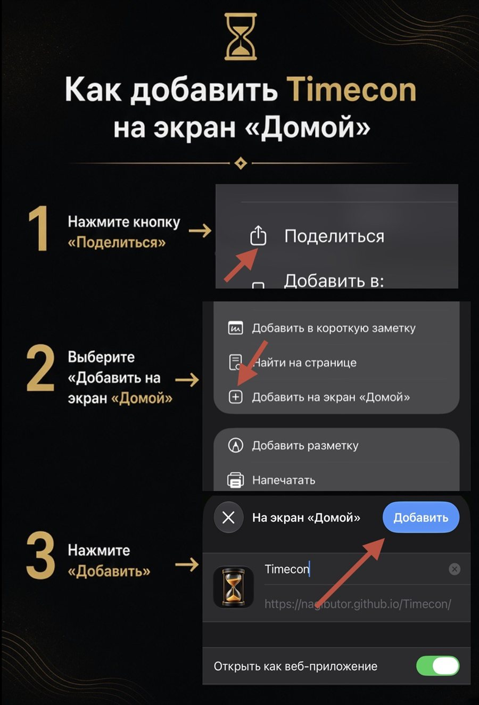
</p>

### Шаг 5. Вход и синхронизация

1. На первом устройстве: **Настройки → Синхронизация**, почта и пароль (минимум 6 символов), **Регистрация**. Вместо пароля можно нажать **«Войти через Google»**.
2. На втором устройстве: те же почта и пароль, **Войти** (или снова через Google).

---

## Ограничения

- **Переход с JavaScript-версии.** Используется прежний ключ `timecon.v1` и прежняя таблица Supabase: задачи, заметки, пресеты, финансы и активные таймеры читаются автоматически. Старые JSON-экспорты поддерживаются. При повреждённом локальном JSON исходная строка сохраняется в `timecon.corrupt-backup.*`, а не удаляется.
- **WebAssembly.** Требуется современный браузер с WASM. JavaScript нужен только для загрузки WASM и сгенерированных привязок браузерных API; полностью убрать JS из браузерного PWA технически нельзя.

- **iPhone и фоновый таймер.** Safari приостанавливает приложение в фоне. Обратный отсчёт в приложении хранится по времени окончания, поэтому при возврате покажет правильное значение и сразу сообщит об окончании, но сигнала в момент окончания может не быть, если приложение закрыто. Вибрация в Safari на iPhone не поддерживается. Это ограничение браузерной версии, нативная версия решила бы его полностью.
- **Конфликты.** Для задач и заметок побеждает более свежая правка. Перенесённая задача остаётся только в одном дне; метки удаления не дают старым копиям вернуть удалённые записи. Для остальных коллекций при конфликте одной записи приоритет у локальной копии. Старые клиенты без меток удаления могут вести себя иначе — обнови все устройства.
- **Автозапуск** работает, пока приложение открыто (в том числе в фоне на компьютере). Если указанное время прошло больше двух часов назад, задача сама не запустится.
- **Фото в заметках** хранятся внутри данных приложения и сжимаются до 1280 точек по длинной стороне. Большое число крупных фото может переполнить хранилище браузера; при переполнении появится предупреждение.
- **Первый вход на новом устройстве.** Данные с сервера заменяют локальные, если на сервере уже есть данные.

---

## Если что-то не работает

- **Синхронизация не работает в своей копии**: проверь `TIMECON_SUPABASE_URL` и `TIMECON_SUPABASE_KEY`, затем пересобери.
- **«Ошибка синхронизации»**: проверь интернет, URL и ключ. Точный текст ошибки виден в разделе синхронизации.
- **Изменения не приходят мгновенно**: не выполнен `supabase-realtime.sql` (шаг 1.6). Без него работает подстраховка раз в 15 секунд.
- **Просит подтвердить почту**: не отключено **Confirm email** (шаг 1.5).
- **`relation timecon_state does not exist`**: не выполнен `supabase.sql` (шаг 1.3).
- **На телефоне старая версия**: закрой все окна приложения и открой заново. В настройках должно быть `Timecon v34 · Rust`. Номер кэша вычисляется при сборке; `sw.js` генерируется автоматически.
- **Переход со старого адреса**: если иконка на экране «Домой» была добавлена со старого адреса, удали её и добавь заново с нового — иначе останешься на старой версии сайта.
